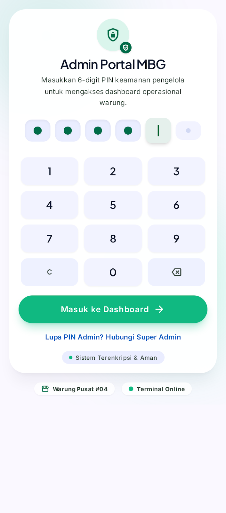
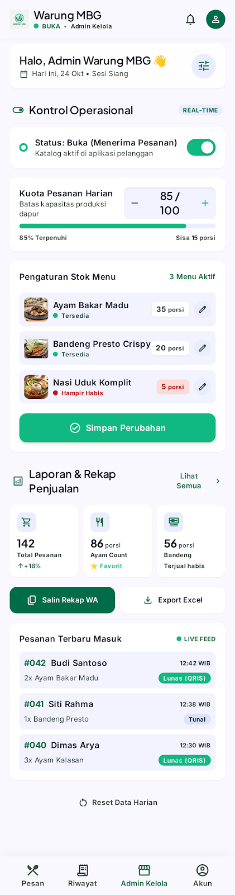

<div align="center">

# 🍱 Panji MBG

**Aplikasi Web Pemesanan Makanan Harian — Cepat, Ringan, & Tanpa Ribet**

[](https://go.dev/)
[](https://gin-gonic.com/)
[-003B57?style=flat-square&logo=sqlite&logoColor=white)](https://pkg.go.dev/modernc.org/sqlite)
[](https://alpinejs.dev/)
[](https://www.docker.com/)

Aplikasi pemesanan katering/warung makan berbasis **Go (Gin) + SQLite + Tailwind/Alpine.js** dalam satu binary ringan. Dirancang agar pelanggan bisa memesan dalam hitungan detik dari HP tanpa login, sementara dapur/admin dapat mengatur kuota, menu, rekap WhatsApp, dan export Excel secara *real-time*.

</div>

---

## ✨ Fitur Utama

### 👤 Pelanggan (Tanpa Login)
- **Status Real-Time:** Indikator langsung `🟢 Warung Buka` / `🔴 Warung Tutup` beserta sisa kuota porsi hari ini.
- **Multi-Item & Multi-Qty:** Satu orang bisa memesan lebih dari satu porsi sekaligus atau kombinasi beberapa menu utama & *add-ons* menggunakan tombol stepper `−` / `+`.
- **Kategori Custom Fleksibel:**
  - *Quick chips* sekali klik (contoh: `Tanpa Nasi`, `Tanpa Kerupuk`, `Tanpa Sayur/Tumis`, `Nasi Setengah`).
  - Kolom catatan bebas untuk detail spesifik (contoh: *"1 porsi ayam tanpa nasi, sambal pisah"*).
- **Kalkulasi Harga Otomatis:** Otomatis membaca label harga pada nama menu seperti `(15k)` atau `(3k)` untuk menampilkan estimasi total tagihan.
- **Pembayaran Cash & QRIS:** Menampilkan kartu **QRIS resmi MBG APS** lengkap dengan tombol unduh gambar QRIS agar mudah di-*scan* dari galeri HP.

### 🔐 Admin Dashboard (Protected 6-Digit PIN)
- **PIN Keypad Modern:** Login aman menggunakan 6-digit PIN dengan proteksi *brute-force* (otomatis *lockout* 5 menit setelah 5x salah PIN).
- **Kontrol Operasional Instan:** *Switch* Buka/Tutup warung dan pengaturan kuota porsi global harian dengan indikator *progress bar*.
- **Manajemen Menu Dinamis:** Tambah, ubah, atau hapus daftar **Menu Utama**, **Add-ons**, dan **Opsi Kategori Custom** kapan saja tanpa menyentuh kode.
- **Pengaturan QRIS & PIN:** Ubah gambar QRIS (via URL atau *upload* file langsung) serta ganti PIN Admin dari dashboard.
- **Laporan & Rekap Otomatis:**
  - Ringkasan total porsi terjual, jumlah pemesan, hitungan per menu utama, *add-ons*, pesanan *custom*, dan metode bayar.
  - **Salin Rekap WA:** Menyalin format teks rapi siap *paste* ke grup WhatsApp dapur/pelanggan.
  - **Export Excel (`.xlsx`):** Mengunduh laporan lengkap berisi 2 *sheet* (*Pesanan* & *Ringkasan*) lengkap dengan *styling* tabel dan *auto-filter*.
  - **Reset Data Harian:** Menghapus daftar pesanan hari ini (nomor urut kembali ke `#001`) tanpa menghapus konfigurasi menu.

---

## 🖼️ Preview Desain UI

| Form Pelanggan | Login PIN Admin | Dashboard Admin |
| :---: | :---: | :---: |
|  |  |  |

---

## 🛠️ Tech Stack & Arsitektur

| Komponen | Teknologi | Keterangan |
| :--- | :--- | :--- |
| **Backend** | Go 1.21+ (`github.com/gin-gonic/gin`) | Single-file REST API + static file server |
| **Database** | SQLite (`modernc.org/sqlite`) | Pure Go SQLite driver (tanpa CGO, mode WAL aktif) |
| **Excel Engine** | `github.com/xuri/excelize/v2` | Generator laporan `.xlsx` multi-sheet di memori |
| **Frontend** | HTML5 + Tailwind CSS + Alpine.js | Glassmorphism UI responsif (*mobile-first*), tanpa *build step* Node.js |
| **Deployment** | Docker Multi-Stage + Nginx | Image akhir berbasis `alpine:latest` (~20 MB) |

```text
mbg-panji/
├── main.go              # Seluruh logika backend: SQLite, Auth PIN, REST API, & Export Excel
├── index.html           # Single-Page App (Pelanggan & Admin Dashboard)
├── qris.jpg             # Gambar QRIS default (MBG APS, Layanan Katering)
├── run-dev.ps1          # Script helper menjalankan server lokal di Windows (tanpa Docker)
├── Dockerfile           # Multi-stage build (golang:1.21-alpine -> alpine:latest)
├── docker-compose.yml   # Konfigurasi container & volume persistence ./data
├── go.mod / go.sum      # Dependensi Go
└── data/                # (Otomatis dibuat) Lokasi file SQLite app.db
```

---

## 💻 Menjalankan di Lokal (Development — Tanpa Docker)

Untuk pengembangan di PC lokal (Windows / macOS / Linux), **tidak perlu Docker**. Cukup pastikan **Go 1.21+** sudah terpasang.

### Di Windows (PowerShell)
```powershell
git clone https://github.com/ipangpangeran/mbg-panji.git
cd mbg-panji

# Jalankan dengan script dev:
.\run-dev.ps1

# Atau jalankan langsung:
go run .
```
> Jika PowerShell menolak eksekusi script, jalankan sekali: `Set-ExecutionPolicy -Scope CurrentUser RemoteSigned`

### Di Linux / macOS
```bash
git clone https://github.com/ipangpangeran/mbg-panji.git
cd mbg-panji
TZ=Asia/Jakarta GIN_MODE=debug go run .
```

Buka di browser:
- **Halaman Pemesanan:** `http://localhost:8080`
- **Halaman Admin:** `http://localhost:8080/#admin` *(PIN awal default: `123456`)*

> **Tips format penulisan harga menu di Admin:**
> Akhiri nama menu dengan tanda kurung harga seperti `(15k)`, `(3k)`, atau `(Rp 15.000)`, dan pisahkan deskripsi isi paket dengan ` - `.
> Contoh: `Paket Ayam - Nasi + Ayam Rendang + Tumis Buncis + Krupuk (15k)` — UI otomatis memisahkan judul, rincian lauk, serta menghitung estimasi total belanja pelanggan.

---

## 🔌 Dokumentasi REST API

Seluruh *endpoint* admin dilindungi menggunakan HTTP Header `X-Admin-Pin: <6-digit-pin>`.

| Method | Endpoint | Akses | Deskripsi |
| :--- | :--- | :---: | :--- |
| `GET` | `/api/config` | Publik | Mengambil status buka/tutup, kuota, sisa slot, daftar menu, opsi custom, & URL QRIS (PIN tidak pernah diekspos) |
| `POST` | `/api/login` | Publik | Verifikasi 6-digit PIN admin (`{"pin": "123456"}`) |
| `POST` | `/api/order` | Publik | Mengirim pesanan baru (validasi status buka & sisa kuota porsi secara atomik) |
| `POST` | `/api/config` | **Admin** | Update parsial konfigurasi (`is_open`, `global_quota`, `main_menus`, `side_menus`, `custom_options`, `qr_url`, `admin_pin`) |
| `GET` | `/api/orders` | **Admin** | Daftar seluruh pesanan diurutkan dari yang terbaru |
| `DELETE` | `/api/orders` | **Admin** | Reset/hapus semua pesanan hari ini & kembalikan nomor urut ke `#001` |
| `GET` | `/api/summary` | **Admin** | Statistik total porsi, jumlah transaksi, rekap per item, custom, & metode bayar |
| `GET` | `/api/export/excel` | **Admin** | Unduh file `.xlsx` (*Sheet 1: Pesanan*, *Sheet 2: Ringkasan*) |
| `GET` | `/healthz` | Publik | Healthcheck container & koneksi database |

<details>
<summary><b>Contoh Payload <code>POST /api/order</code></b></summary>

```json
{
  "name": "Budi Santoso",
  "main_menus": [
    {
      "name": "Paket Ayam - Nasi + Ayam Rendang + Tumis Buncis Labu Siam + Krupuk (15k)",
      "qty": 2
    }
  ],
  "side_menus": [
    { "name": "Martabak Tahu 2pcs (3k)", "qty": 1 },
    { "name": "Orek Tempe (3k)", "qty": 2 }
  ],
  "custom_options": ["Tanpa Kerupuk"],
  "custom_note": "1 porsi tanpa nasi, sambal dipisah",
  "payment_method": "qris"
}
```
</details>

---

## ⚙️ Variabel Environment

| Variabel | Default | Keterangan |
| :--- | :--- | :--- |
| `PORT` | `8080` | Port HTTP tempat server berjalan |
| `DB_PATH` | `data/app.db` | Lokasi penyimpanan file database SQLite (`/app/data/app.db` di dalam Docker) |
| `STATIC_DIR` | `.` | Direktori file statis `index.html` dan `qris.jpg` |
| `TZ` | `Asia/Jakarta` | Zona waktu pencatatan jam pesanan & penamaan file export |
| `ADMIN_PIN` | `123456` | PIN 6-digit awal (**hanya dipakai saat database pertama kali dibuat**) |
| `GIN_MODE` | `release` | Mode Gin (`debug` untuk lokal, `release` untuk production) |

---

## 🚀 Deployment ke Production (Ubuntu + Docker + Nginx)

Panduan lengkap men-deploy **Panji MBG** di VPS Ubuntu 22.04 / 24.04 menggunakan Docker Compose dan Nginx Reverse Proxy.

### 1. Persiapan Docker di Server Ubuntu
```bash
sudo apt update && sudo apt install -y ca-certificates curl gnupg git
sudo install -m 0755 -d /etc/apt/keyrings
curl -fsSL https://download.docker.com/linux/ubuntu/gpg | sudo gpg --dearmor -o /etc/apt/keyrings/docker.gpg
echo "deb [arch=$(dpkg --print-architecture) signed-by=/etc/apt/keyrings/docker.gpg] https://download.docker.com/linux/ubuntu $(. /etc/os-release && echo $VERSION_CODENAME) stable" \
  | sudo tee /etc/apt/sources.list.d/docker.list > /dev/null
sudo apt update
sudo apt install -y docker-ce docker-ce-cli containerd.io docker-buildx-plugin docker-compose-plugin
sudo usermod -aG docker $USER
```

### 2. Clone Repository & Atur PIN Awal
```bash
sudo mkdir -p /opt/mbg-panji && sudo chown $USER:$USER /opt/mbg-panji
cd /opt/mbg-panji
git clone https://github.com/ipangpangeran/mbg-panji.git .
mkdir -p data
```
Edit `docker-compose.yml` bila perlu:
- Ubah `ADMIN_PIN=123456` ke 6 digit PIN pilihanmu sebelum menjalankan pertama kali.
- Jika Nginx berada di server yang sama, disarankan mengubah `ports` menjadi `"127.0.0.1:8080:8080"` agar port `8080` tidak terekspos langsung ke publik.

### 3. Build & Jalankan Container
```bash
docker compose up -d --build
docker compose ps
curl http://127.0.0.1:8080/healthz   # Output: {"ok":true}
```

### 4. Konfigurasi Nginx Reverse Proxy
```bash
sudo apt install -y nginx
sudo nano /etc/nginx/sites-available/mbg-panji
```
Masukkan konfigurasi berikut (ganti `panji.domainkamu.com` dengan domain asli):
```nginx
server {
    listen 80;
    server_name panji.domainkamu.com;

    client_max_body_size 4m; # Mengizinkan upload gambar QRIS dari dashboard admin

    location / {
        proxy_pass http://127.0.0.1:8080;
        proxy_http_version 1.1;
        proxy_set_header Host              $host;
        proxy_set_header X-Real-IP         $remote_addr;
        proxy_set_header X-Forwarded-For   $proxy_add_x_forwarded_for;
        proxy_set_header X-Forwarded-Proto $scheme;
        proxy_read_timeout 60s;
    }
}
```
Aktifkan virtual host:
```bash
sudo ln -s /etc/nginx/sites-available/mbg-panji /etc/nginx/sites-enabled/
sudo nginx -t && sudo systemctl reload nginx
```

### 5. Aktifkan HTTPS Gratis (Let's Encrypt)
Wajib menggunakan HTTPS di production agar header PIN Admin terenkripsi dan fitur *Clipboard* (**Salin Rekap WA**) berjalan lancar di semua browser HP:
```bash
sudo apt install -y certbot python3-certbot-nginx
sudo certbot --nginx -d panji.domainkamu.com
```

---

## 🔄 Update & Backup di Server

### Update ke Versi Terbaru dari GitHub
```bash
cd /opt/mbg-panji
git pull origin main
docker compose up -d --build
docker image prune -f
```

### Backup Database SQLite
Seluruh data pesanan & konfigurasi tersimpan aman di `./data/app.db`:
```bash
sudo apt install -y sqlite3
sqlite3 /opt/mbg-panji/data/app.db ".backup '/opt/mbg-panji/backup-$(date +%F).db'"
```

### Reset PIN Admin (Jika Lupa)
Jalankan dari host server pada folder project:
```bash
sqlite3 data/app.db "UPDATE Config SET value='123456' WHERE key='admin_pin';"
```

---

<div align="center">
  <sub>Dibuat dengan ❤️ untuk operasional <b>Panji MBG (MBG APS, Layanan Katering)</b></sub>
</div>
